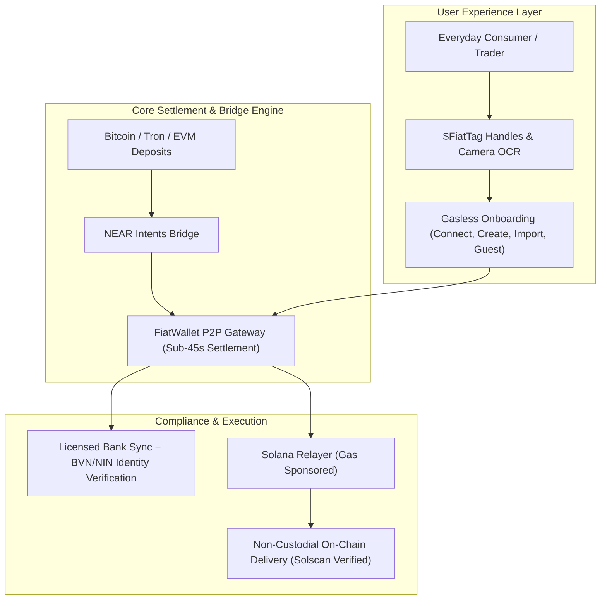

# FiatWallet — Executive Overview & Strategic Whitepaper

> **Confidential & Proprietary** | Version 1.2 — November 2026  
> **Official Website:** [https://fiatwallet.app](https://fiatwallet.app)  
> **X (Twitter):** [@fiatwallet](https://x.com/fiatwallet)  
> **Telegram Community:** [t.me/fiatwalletApp](https://t.me/fiatwalletApp)  
> **Direct Contact:** `fiatwalletapp@gmail.com`  

---

## 1. Executive Summary

**FiatWallet** is an on-chain, non-custodial Solana smart wallet, cross-chain deposit bridge, and compliant P2P gateway engineered to resolve the fiat-to-crypto last mile across emerging markets. 

By unifying **institutional-grade identity compliance (BVN / NIN verification)** with **gasless Web2 consumer UX**, FiatWallet enables individuals, merchants, and institutions to buy, sell, swap, and bridge digital dollars (USDC/USDT) directly to and from domestic bank accounts in **under 45 seconds**.

---

## 2. Key Product Architecture

### Core Innovations:
* **Sub-45s Automated Settlement:** Instant automated bank disbursement and on-chain token forwards—eliminating escrow delays and manual counterparty confirmation.
* **Gasless Relayer Infrastructure:** Proprietary serverless relayer sponsors network gas for offramps and forwards. Users can transact seamlessly with 0 native SOL balance.
* **Multi-Chain Chain Abstraction:** Powered by NEAR Intents (Chain Defuser). Direct native deposits from **Bitcoin (BTC)**, **Tron (TRC-20 USDT/TRX)**, and EVM chains (**Base, Arbitrum, Polygon, Ethereum, BNB Chain**) directly into Solana with zero wrapped-token risk.
* **Consumer-First Payment UX:**
  * **FiatTags (`$tag`):** Human-readable handles (e.g., `$fiatwallet`, `$ultradefi`) replace complex 44-character addresses and 10-digit bank numbers.
  * **Camera OCR Scanner:** Built-in computer vision extracts printed or written 10-digit bank account numbers in one tap.
  * **Solana Rent Reclaim:** Automated audit tool recovering dormant SOL locked in closed SPL token accounts.
  * **Cross-Device Persistent Sessions:** Encrypted 4-digit OTP email verification maintaining secure 20-year sessions across all user devices.

---

## 3. Traction & Operational Metrics

| Metric | Performance | Description / Benchmark |
| :--- | :--- | :--- |
| **Average Settlement Speed** | **< 45 Seconds** | 98% of on-ramps and off-ramps settle end-to-end automatically. |
| **System Reliability** | **99.9% Uptime** | Edge-deployed serverless micro-architecture with automated RPC failover. |
| **Gasless Execution Rate** | **100%** | Zero failed user transactions caused by insufficient native SOL gas. |
| **Recovery Efficiency** | **100% Delivery** | Autonomous offline sweepers guarantee delivery even if users close browsers. |

---

## 4. Problem & Market Opportunity *(Why Nigeria, Why Now)*

### The Pain Point
Informal peer-to-peer crypto trading (Binance P2P, Bybit, Telegram OTC) in emerging markets is severely broken:
1. **The Bank Freeze Epidemic (PND):** Unvetted counterparties route illicit funds, triggering immediate Post-No-Debit (PND) account freezes by commercial banks.
2. **The "Gas Trap":** Inexperienced users receive stablecoins but cannot move or cash out without first acquiring native SOL for transaction fees.
3. **Cryptographic Friction:** 44-character addresses and manual bank data entry cause frequent capital loss and drop-off.

### The Market Opportunity
* **Global Adoption Leader:** Nigeria ranks **#2 globally in crypto adoption** (Chainalysis) and leads the world in peer-to-peer stablecoin usage.
* **Flight to Digital Dollars:** Rapid local currency depreciation has made USDC/USDT the primary tool for capital preservation, freelance earnings, and cross-border trade settlements ($50B+ annual sub-Saharan volume).
* **Regulatory Shift:** Regulators (including SEC Nigeria's VASP and Accelerated Regulatory Incubation Programme - ARIP) are establishing clear rules favoring transparent, compliant, KYC-verified fintech rails over unregulated shadow P2P.

---

## 5. Business Model & Scalable Economics

FiatWallet generates revenue through multi-tiered transaction spreads and protocol fees:

| Revenue Stream | Mechanism | Pricing / Margin |
| :--- | :--- | :--- |
| **Onramp Protocol Fee** | Automated deduction on gross fiat-to-crypto forwards | **0.40%** per transaction ($0.10 minimum floor) |
| **FX Conversion Spread** | Dynamic spread on real-time NGN/USDC liquidity pairs | **0.50% – 1.00%** |
| **Cross-Chain Bridge Routing** | Ingestion spread on native BTC, Tron, and EVM transfers | **0.25% – 0.50%** |
| **B2B Checkout API *(Upcoming)*** | Merchant gateway fees for Web2/Web3 apps accepting Solana payouts | **0.75% – 1.20%** |

### Unit Economics & Net Margins
* **Near-Zero Gas Overhead:** Solana network fees average **~$0.00025 per transaction (< 0.000005 SOL)**, allowing FiatWallet to sponsor user fees while maintaining **> 90% gross profit margins** on protocol fees.
* **High Lifetime Value (LTV):** High user retention driven by daily and weekly recurring settlement needs (freelance payouts, merchant settlements, trading profits).

---

## 6. Competitive Advantage *(Our Moat)*

1. **Compliance as a Shield:** Direct BVN/NIN identity verification and verified banking rails completely eliminate account freezes and fraud that plague informal P2P.
2. **Web2 Simplicity on Web3 Rails:** Human-readable `$FiatTag` handles, camera OCR scanner, 4 flexible onboarding modes, and gasless relayer allow seamless adoption by everyday non-crypto users.
3. **Multi-Chain Liquidity Ingestion:** Frictionless deposits from Bitcoin, Tron, and EVM chains directly into Solana via NEAR Intents chain abstraction.
4. **Strictly Non-Custodial Integrity:** Private keys and seed phrases remain encrypted locally on client devices (AES-256 vault) and never touch centralized servers.

---

## 7. Regulatory & Banking Strategy

* **Licensed Partner Rails:** Fiat transactions and domestic banking disbursements are executed via licensed payment gateway infrastructure (**PajCash**), ensuring strict AML/CFT compliance.
* **Regulatory Alignment:** Architecture built to align with **SEC Nigeria’s Virtual Asset Service Provider (VASP)** and **ARIP** sandbox guidelines.
* **Segregated Risk Architecture:** Commercial banks settle purely domestic fiat-to-fiat transactions without direct crypto balance exposure, insulating users and banking partners from regulatory friction.

---

## 8. The Team & "The Ask"

### Founding Leadership

* **Augustine Onimisi (easytrend)** — Founder & Lead Architect  
  **X (Twitter):** [@easytrend_](https://x.com/easytrend_)  
  *Leading product architecture, high-throughput Solana relayer infrastructure, and compliant fintech settlement rails across emerging markets.*

* **Micheal Olatunde** — Operations & Data Analyst  
  **X (Twitter):** [@realcryptopikin](https://x.com/realcryptopikin) | **LinkedIn:** [miczino](https://linkedin.com/in/miczino)  
  *Overseeing daily fiat-to-crypto settlement operations, liquidity tracking, interbank transaction reconciliation, and user data analytics.*

* **Favour Michael** — Social Media Manager  
  **LinkedIn:** [favourmichaell](https://linkedin.com/in/favourmichaell)  
  *Managing multi-channel social growth, Web3 brand narrative, community engagement, and digital education across consumer touchpoints.*

* **Arudi Valentine** — Software & Technical Support Engineer  
  **X (Twitter):** [@arudi_valentine](https://x.com/arudi_valentine)  
  *Leading core software engineering, technical support architecture, and user-centric system innovations across the FiatWallet ecosystem.*

### Core Capabilities
* **High-Throughput Solana Infrastructure:** Low-latency RPC routing, custom transaction relayers, and serialized token forwards.
* **Emerging Market Payments:** Direct integration with Nigerian NIP interbank rails and banking APIs.
* **Cryptographic & Database Security:** Enterprise PostgreSQL RLS and cryptographic anti-tamper security.

### Current Objectives & The Ask
1. **Liquidity & Settlement Partners:** Strategic capital partners to scale NGN/USDC automated settlement pools as daily volume grows.
2. **Ecosystem & Foundation Grants:** Funding to accelerate mobile APK native distribution, Merchant SDK expansion, and pan-African rollout (Ghana, Kenya, South Africa).
3. **Strategic Advisory:** Institutional leaders in African fintech compliance and digital asset licensing.

---

*Direct Contact: **`fiatwalletapp@gmail.com`** | Telegram: **[@fiatwalletApp](https://t.me/fiatwalletApp)** | Web: **[https://fiatwallet.app](https://fiatwallet.app)***
